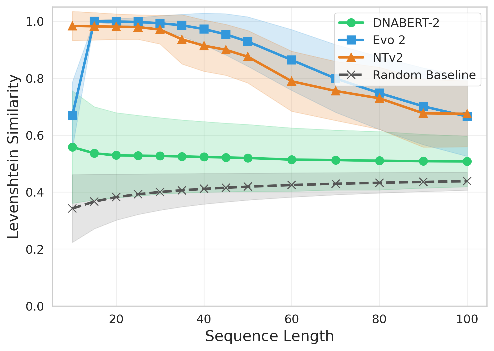

# How Private Are DNA Embeddings? Inverting Foundation Model Representations of Genomic Sequences
[](https://arxiv.org/abs/2603.06950) [](https://juleskreuer.eu//projects/citation-badge) [](https://huggingface.co/not-a-feature/DNA-Embedding-Inversion)
> [!NOTE]
> **Authors:** Jules Kreuer*, Sofiane Ouaari*, Nico Pfeifer<br>
>  *: Shared first authorship.<br>
>
> Methods in Medical Informatics, Department of Computer Science & Institute for Bioinformatics and Medical Informatics (IBMI)<br>
> University of Tübingen, Germany


## Overview

Code and results for [How Private Are DNA Embeddings?](https://arxiv.org/abs/2603.06950).
We benchmark reconstruction from mean-pooled DNABERT-2, Evo 2 and NTv2
embeddings. One Length-Conditioned Query Decoder (LCQD) per foundation model
covers 14 sequence lengths, from 10 to 100 nucleotides. Evaluations use
held-out hg38 windows, individual-specific 1000 Genomes sequences and
cohort identification with known or alignment-inferred coordinates.



## Results

- [hg38 reconstruction and identification](outputs/README.md)
- [1000 Genomes reconstruction](outputs_1000g/README.md)
- [Layer sensitivity](outputs/layer_sensitivity_v1/README.md): four extraction
  points per model, with 100,000 training sequences per length.

The repository includes metric summaries and plots. Raw data, embeddings and
checkpoints are not included. For identification, a budget of `k` loci supplies
`2k` haplotype embeddings. The known-coordinate attack is a reference comparison,
not a formal upper bound on the alignment-based attack.

## Using the decoder models
Go to https://huggingface.co/not-a-feature/DNA-Embedding-Inversion and follow the intructions.

## Run the benchmark

Install dependencies in an activated Python environment:

```bash
uv pip install -r requirements.txt
```

With hg38 and the foundation-model runtimes installed, run from Linux or WSL:

```bash
python scripts/prepare_hg38_multilen.py \
  --fasta data/hg38.fa \
  --output data/hg38_multilen_seqdisjoint/hg38_multilen_seqdisjoint.h5
MAX_JOBS=1 NUM_GPUS=1 bash run_experiments_multilen.sh
```

Population experiments also require `bcftools`, `bwa`, `samtools` and phased,
reference-compatible VCFs at `data/1000g_vcfs/chr1.vcf.gz` through `chr22.vcf.gz`.
Install the Evo 2 runtime separately. Check the configuration of linked model
weights before use; the archive may contain weights from earlier releases.

Benchmark code is in `src/`, `conf/`, `generate/`, `embedding_analysis/` and
`scripts/`; regression tests are in `tests/`. Baseline architectures and
`tokenizer_ablation/` support the preliminary experiments described in the paper.

## License

This project is licensed under the [European Union Public Licence 1.2 (EUPL-1.2)](LICENSE).

## Acknowledgments

This work was supported by the Carl Zeiss Stiftung Research Project "Certification and Foundations of Safe Machine Learning Systems in Healthcare", by the German Research Foundation (DFG) under Germany's Excellence Strategy—EXC number 2064/1—Project number 390727645, and by the German Federal Ministry of Research, Technology and Space (BMFTR) within the PrivateAIM project (funding number: 01ZZ2316D). The authors thank the International Max Planck Research School for Intelligent Systems (IMPRS-IS).
